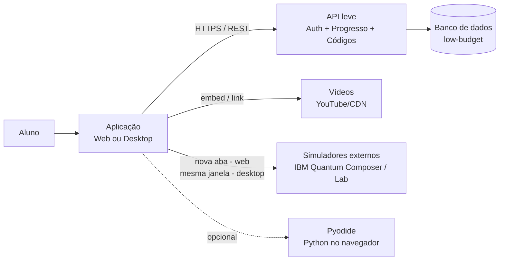
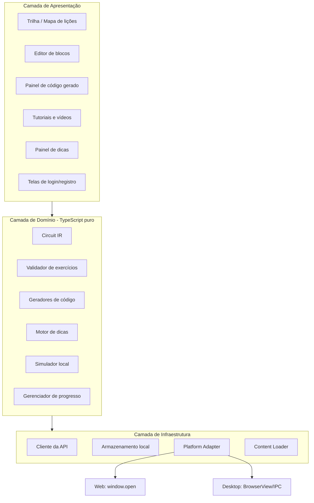
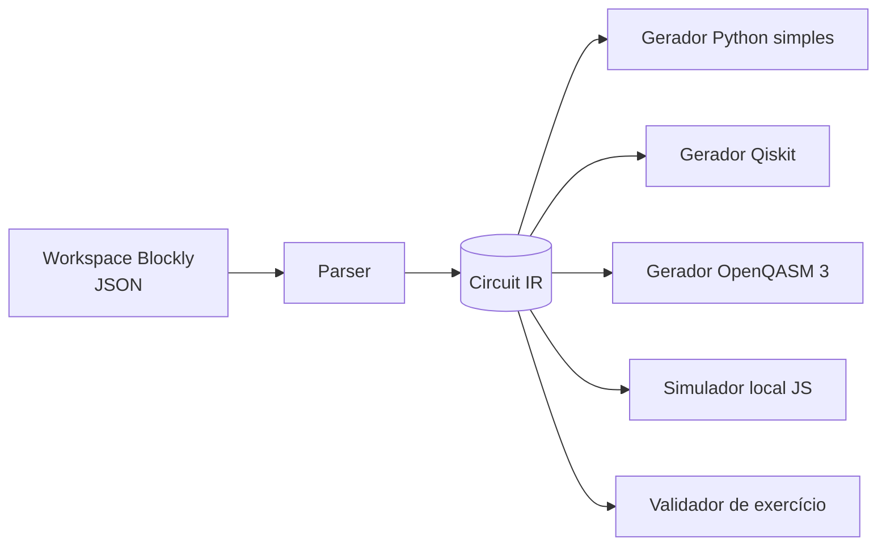
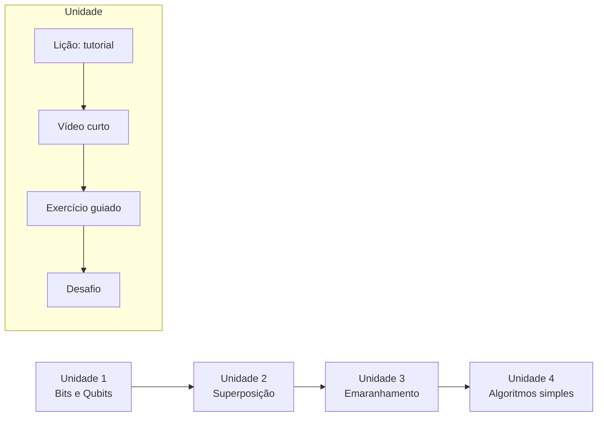
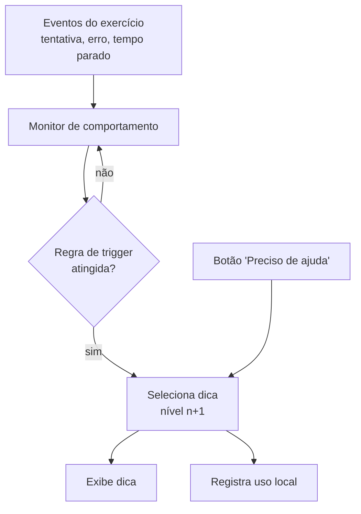
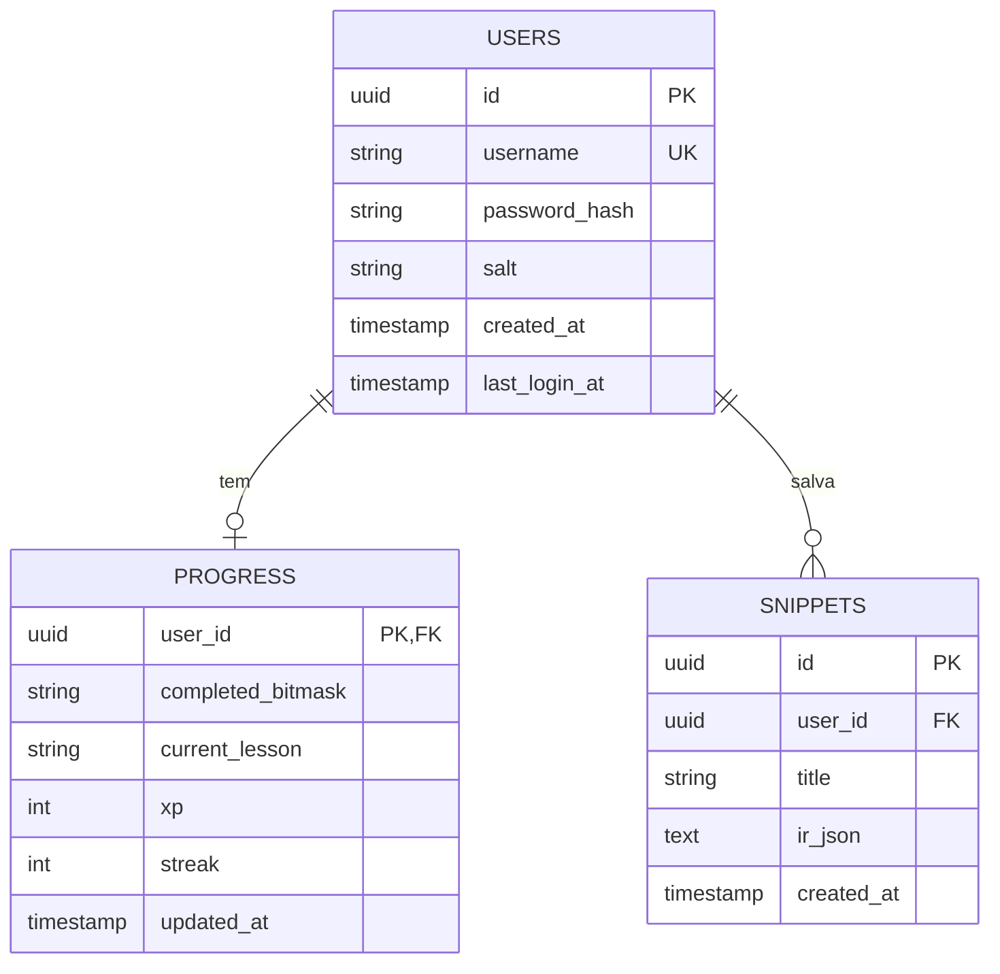
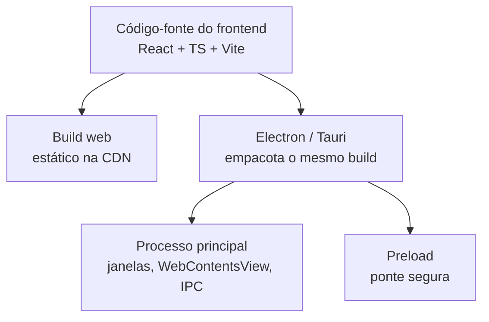
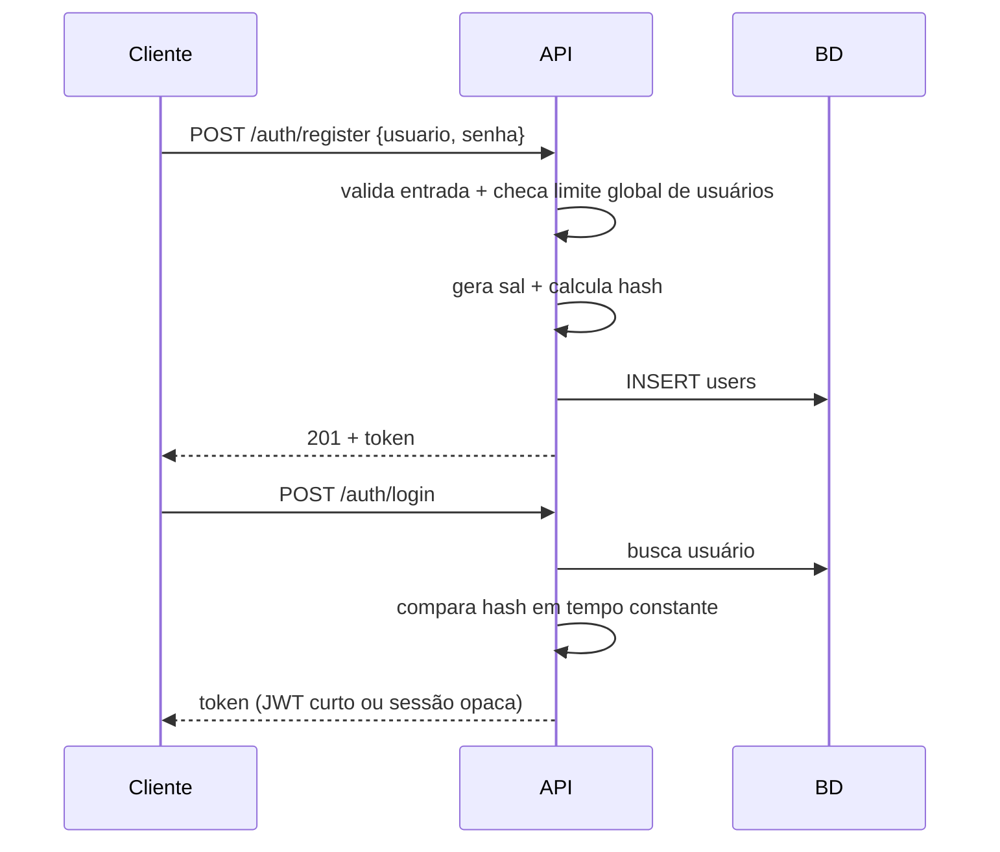

# ARCHITECTURE.md

**Projeto:** Plataforma de ensino de programação quântica com blocos (estilo Scratch) e trilha gamificada (estilo Duolingo/Grasshopper)
**Versão do documento:** 0.1 (rascunho inicial)
**Status:** Proposta de arquitetura para TCC

> As tecnologias citadas são **recomendações justificadas**, não obrigações. Cada escolha está registrada na seção 12 (ADRs) com alternativas, para que você possa defender ou trocar a decisão na banca.

---

## 1. Visão geral

### 1.1 Objetivo
Ensinar conceitos e programação quântica a iniciantes, sem exigir conhecimento prévio de Python, Qiskit ou álgebra linear avançada. O aluno monta circuitos quânticos com **blocos visuais**, avança por uma **trilha de lições curtas** e pode **traduzir** o que montou para código Python e levá-lo a simuladores reais (ex.: IBM Quantum).

### 1.2 Requisitos funcionais (RF)

| ID | Requisito |
|----|-----------|
| RF01 | Editor de programação em blocos para circuitos quânticos |
| RF02 | Trilha de aprendizagem com lições, níveis, progresso e desbloqueio sequencial |
| RF03 | Cadastro e login de usuários |
| RF04 | Persistência de flags de progresso e (opcionalmente) códigos salvos |
| RF05 | Tradutor de blocos para Python simples (simulável localmente), Qiskit e OpenQASM |
| RF06 | Tutoriais e vídeos curtos integrados às lições |
| RF07 | Sistema de dicas: manual (botão) e automático (triggers de dificuldade) |
| RF08 | Redirecionamento a simuladores externos: **nova aba** na web, **mesma janela** no standalone |
| RF09 | Versão standalone (desktop) com a mesma base de código da web |

### 1.3 Requisitos não funcionais (RNF)

| ID | Requisito | Estratégia |
|----|-----------|------------|
| RNF01 | Baixo custo de infraestrutura | Frontend estático (CDN), backend mínimo/serverless, BD em plano gratuito |
| RNF02 | Limite de I/O do banco e de usuários | Quotas, rate limiting, escrita em lote, cache local (seção 8) |
| RNF03 | Segurança proporcional (sem dados sensíveis) | Hash de senha com sal, HTTPS, validação de entrada (seção 7) |
| RNF04 | Um único código-fonte para web e desktop | Frontend agnóstico de plataforma + camada de adaptação (seção 6) |
| RNF05 | Funcionar com degradação elegante offline | Lições e simulação local funcionam sem rede; sincroniza depois |
| RNF06 | Acessibilidade e uso em dispositivos modestos | Simulador local leve, vídeos sob demanda |

### 1.4 Princípios de projeto
1. **Cliente gordo, servidor magro.** Quase toda a lógica (editor, tradução, validação de exercícios, dicas) roda no cliente. O servidor só autentica e guarda poucos bytes.
2. **Conteúdo como dado.** Lições, exercícios e dicas são arquivos versionados (JSON/YAML), não código.
3. **Uma representação intermediária (IR) do circuito.** Blocos, Python, Qiskit e QASM são apenas "visões" da mesma IR.
4. **Adaptadores de plataforma.** O que muda entre web e desktop fica isolado em uma interface única.

---

## 2. Diagrama de contexto



---

## 3. Arquitetura em camadas (frontend)



**Regra de dependência:** a camada de domínio **não conhece** React, Electron nem a rede. Isso permite testá-la com testes unitários simples e reutilizá-la integralmente nas duas versões.

---

## 4. Módulos

### 4.1 Editor de blocos (RF01)

- **Biblioteca sugerida:** [Blockly](https://developers.google.com/blockly) (Google). É a base do Scratch, permite blocos customizados, geradores de código e serialização em JSON.
- **Alternativa:** `scratch-blocks` (mais fiel ao visual do Scratch, porém menos mantido e mais difícil de integrar).

**Categorias de blocos (sugestão):**

| Categoria | Blocos |
|-----------|--------|
| Qubits | `criar qubits (n)`, `medir qubit (q)` |
| Portas de 1 qubit | `X`, `Y`, `Z`, `H`, `S`, `T`, `Rx/Ry/Rz(θ)` |
| Portas de 2+ qubits | `CNOT`, `CZ`, `SWAP`, `Toffoli` |
| Controle | `repetir n vezes`, `se resultado = ...` (clássico, simplificado) |
| Execução | `executar (shots)`, `mostrar histograma` |

**Restrição pedagógica:** blocos são **desbloqueados progressivamente** pela trilha (a lição define a `toolbox` disponível). Isso reduz sobrecarga cognitiva e reforça a progressão.

### 4.2 Circuit IR e tradutor de código (RF05)

O ponto mais importante do sistema: **blocos nunca são traduzidos diretamente para Python.** Passam por uma IR.



**Exemplo de IR (JSON):**

```json
{
  "version": 1,
  "qubits": 2,
  "clbits": 2,
  "ops": [
    { "gate": "h",    "targets": [0] },
    { "gate": "cx",   "controls": [0], "targets": [1] },
    { "gate": "measure", "targets": [0, 1] }
  ],
  "shots": 1024
}
```

**Geradores de saída:**

| Saída | Uso |
|-------|-----|
| **Python simples** (NumPy puro, sem Qiskit) | Aluno lê, entende a matemática e roda localmente. Aqui o código mostra vetor de estado e matrizes das portas, de forma didática |
| **Qiskit** | Caminho "profissional"; compatível com IBM Quantum |
| **OpenQASM 3** | Colar direto no IBM Quantum Composer |

**Exemplo de saída "Python simples" (didática):**

```python
import numpy as np

# Estado inicial |00>
estado = np.array([1, 0, 0, 0], dtype=complex)

# Porta H no qubit 0
H = np.array([[1, 1], [1, -1]]) / np.sqrt(2)
I = np.eye(2)
estado = np.kron(I, H) @ estado

# CNOT (controle 0, alvo 1)
CNOT = np.array([[1,0,0,0],[0,0,0,1],[0,0,1,0],[0,1,0,0]])
estado = CNOT @ estado

probabilidades = np.abs(estado) ** 2
print(probabilidades)  # [0.5 0. 0. 0.5]
```

**Execução local do Python gerado:**
- **Opção A (recomendada para MVP):** o usuário copia/baixa o `.py` e roda no próprio ambiente.
- **Opção B:** [Pyodide](https://pyodide.org) (Python/WASM) roda no navegador/Electron sem servidor. Custo: download inicial de ~10 MB (carregar sob demanda, apenas quando o aluno abrir o painel "Rodar Python").

### 4.3 Simulador local (JS)

Um simulador de vetor de estado em TypeScript (até ~10 qubits) permite:
- Validar exercícios **sem depender de rede nem de Python**.
- Mostrar histograma e esfera de Bloch instantaneamente.
- Comparar o resultado do aluno com o esperado (seção 4.4).

Complexidade: memória e tempo crescem como 2ⁿ. Impor limite de **n ≤ 10 qubits** na UI pedagógica.

### 4.4 Trilha de aprendizagem (RF02)

**Modelo de conteúdo:** Unidade → Lição → Exercício.



**Tipos de exercício:**

| Tipo | Validação |
|------|-----------|
| Múltipla escolha / quiz | Resposta correta no conteúdo |
| Montar circuito para produzir distribuição X | Simulador local compara probabilidades (tolerância ε) |
| Completar blocos faltantes | Compara IR parcial com IR esperada |
| Prever resultado | Resposta numérica / histograma |

**Exemplo de arquivo de lição (YAML):**

```yaml
id: u2-l3-hadamard
title: "Colocando um qubit em superposição"
unit: u2
requires: [u2-l2]
toolbox: [qubit.create, gate.h, gate.x, measure]
video: { provider: youtube, id: "XXXXXXXX", duration_s: 90 }
exercise:
  type: circuit_target
  qubits: 1
  target_distribution: { "0": 0.5, "1": 0.5 }
  tolerance: 0.05
  max_ops: 3
hints:
  - level: 1
    text: "Qual porta cria uma mistura igual de 0 e 1?"
  - level: 2
    text: "Experimente o bloco H antes da medição."
  - level: 3
    text: "Solução: criar 1 qubit → H(0) → medir."
    reveals_solution: true
triggers:
  - { on: wrong_attempts, threshold: 3, hint_level: 1 }
  - { on: idle_seconds,   threshold: 60, hint_level: 1 }
  - { on: same_error_repeated, threshold: 2, hint_level: 2 }
```

**Flags de progresso (o que vai ao banco):** compactas, por design.

```json
{
  "completed": ["u1-l1","u1-l2","u2-l1"],
  "current": "u2-l2",
  "xp": 120,
  "streak": 4,
  "updated_at": "2026-10-29T12:00:00Z"
}
```
Alternativa ainda mais enxuta: *bitmask* (um bit por lição) em um inteiro/string, reduzindo cada atualização a poucos bytes.

### 4.5 Sistema de dicas (RF07)



- **Dicas progressivas** (nível 1 → 3): de pista conceitual a solução.
- **Triggers automáticos** definidos no YAML da lição (tentativas erradas, tempo ocioso, mesmo erro repetido, circuito vazio após N segundos).
- **Dicas contextuais por erro:** o validador devolve um *código de erro* (ex.: `MISSING_MEASURE`, `WRONG_QUBIT_COUNT`) e o motor mapeia para uma dica específica.
- **Penalidade leve opcional:** solução revelada concede menos XP (gamificação), sem bloquear o avanço.
- O motor roda **100% no cliente**. Nenhum custo de servidor.

### 4.6 Tutoriais e vídeos (RF06)

- **Vídeos curtos (≤ 2 min)**, hospedados em **YouTube (embed "nocookie")** ou Cloudflare R2/Bunny (custo muito baixo). Não armazenar vídeos no banco nem no servidor da aplicação.
- Carregamento **lazy**: só incorpora o player quando a lição é aberta.
- **Standalone:** vídeos exigem rede; oferecer fallback com texto/imagens do tutorial. Opcionalmente, empacotar vídeos mais importantes no instalador.
- Tutoriais em **Markdown + componentes interativos** (mini-editor embutido) dentro do conteúdo da lição.

### 4.7 Módulo de simuladores externos (RF08)

Interface única, comportamento distinto por plataforma:

```ts
interface PlatformAdapter {
  openSimulator(url: string, payload?: { qasm?: string }): Promise<void>;
  isDesktop(): boolean;
}
```

| Plataforma | Implementação |
|-----------|---------------|
| **Web** | `window.open(url, "_blank", "noopener,noreferrer")` |
| **Desktop (Electron)** | `WebContentsView` (ou `BrowserView`) dentro da janela principal, com botão "Voltar ao app" |

> ⚠️ **Ponto de atenção técnico:** não use `<iframe>` para embutir o IBM Quantum. Sites como esse normalmente enviam cabeçalhos (`X-Frame-Options` / `Content-Security-Policy: frame-ancestors`) que **bloqueiam iframes**. No Electron, `WebContentsView` é um navegador embutido de verdade e **não sofre essa restrição**, por isso é a abordagem correta para "abrir na mesma janela". Verifique também os termos de uso da IBM para incorporação e mantenha o login do usuário na própria IBM (o app **nunca** vê credenciais da IBM).

**Transferência do circuito:** o app copia o OpenQASM para a área de transferência (e/ou usa parâmetros de URL, se o simulador suportar) e avisa o aluno para colar. Essa integração deve ser tratada como *best effort*, pois não há API estável garantida.

---

## 5. Backend e API

### 5.1 Princípio
Backend **mínimo**: autenticação, progresso e códigos salvos. Sem lógica pedagógica.

### 5.2 Opções de hospedagem (baixo custo)

| Opção | Prós | Contras |
|-------|------|---------|
| **Serverless** (Cloudflare Workers / Vercel / Netlify Functions) + BD gerenciado | Custo ~zero em baixo tráfego, sem servidor para manter | Cold start, limites de execução |
| **Supabase** (Postgres + Auth + RLS) | Auth e BD prontos, plano gratuito | Pausa projetos inativos no plano free; limites de linhas/banda |
| **Node/Express em VPS barato** | Controle total | Você mantém o servidor |
| **SQLite/Turso** | Muito leve, bom para poucos dados | Menos familiar para alguns avaliadores |

**Recomendação para TCC:** frontend estático na CDN + API serverless (ou Supabase) + Postgres/SQLite. Justificativa: demonstra decisões de custo conscientes.

### 5.3 Endpoints (REST, JSON)

| Método | Rota | Descrição | Auth |
|--------|------|-----------|------|
| POST | `/auth/register` | Cria conta (respeitando limite global de usuários) | Não |
| POST | `/auth/login` | Retorna token de sessão | Não |
| POST | `/auth/logout` | Invalida sessão | Sim |
| GET | `/progress` | Lê flags de progresso | Sim |
| PUT | `/progress` | Atualiza progresso (mesclagem, em lote) | Sim |
| GET | `/snippets` | Lista códigos salvos (metadados) | Sim |
| GET | `/snippets/:id` | Lê um código | Sim |
| POST | `/snippets` | Salva código (sujeito a quota) | Sim |
| DELETE | `/snippets/:id` | Remove código | Sim |
| GET | `/health` | Verificação de saúde | Não |

### 5.4 Modelo de dados



**Decisões de modelagem:**
- `PROGRESS` é **uma linha por usuário** (não uma linha por lição) → menos linhas, menos I/O.
- `SNIPPETS` armazena **apenas a IR (JSON compacto)**, não Python/QASM. Os códigos são regenerados sob demanda a partir da IR. Menor armazenamento e sem dados redundantes.
- Sem e-mail obrigatório (menos dado pessoal, menos risco/LGPD). Se houver recuperação de senha, e-mail passa a ser dado pessoal e exige aviso de privacidade.

---

## 6. Estratégia web + standalone (RF09, RNF04)

### 6.1 Abordagem: um frontend, duas "cascas"



- Um **monorepo** com pacotes: `core` (domínio), `ui` (React), `web` (casca web), `desktop` (casca Electron).
- O `desktop` carrega o mesmo bundle e injeta uma implementação diferente de `PlatformAdapter`.

### 6.2 Electron vs. Tauri

| Critério | Electron | Tauri |
|----------|----------|-------|
| Tamanho do instalador | ~80–150 MB | ~5–15 MB |
| Webview embutida para IBM Quantum | `WebContentsView` (Chromium, comportamento previsível) | Webview nativa do SO (varia por plataforma) |
| Maturidade/documentação | Muito alta | Alta, mais nova |
| Linguagem do "main" | JS/TS (mesma do projeto) | Rust |

**Recomendação:** **Electron**, pelo mesmo ecossistema JS/TS e por oferecer comportamento consistente para a janela embutida do simulador. Tauri fica como alternativa documentada.

### 6.3 Segurança no Electron
- `contextIsolation: true`, `nodeIntegration: false`, `sandbox: true`.
- Comunicação apenas via `preload` com canais IPC **em lista de permissão**.
- A `WebContentsView` do simulador externo **sem acesso** ao preload nem a Node.
- Navegação restrita a domínios permitidos (allowlist: domínios da IBM e afins).
- Atualizações automáticas: opcional (`electron-updater`); no MVP, distribuir via GitHub Releases.

### 6.4 Modo offline no standalone
Funcionam sem rede: editor, tradutor, simulador local, lições e dicas (conteúdo empacotado). Dependem de rede: login inicial, sincronização, vídeos e simuladores externos.

---

## 7. Autenticação e segurança (RF03)

### 7.1 Fluxo



### 7.2 Sobre o hash de senha (ponto de atenção importante)

Você mencionou SHA-256. Como o sistema não guarda dados sensíveis, um nível mais simples de segurança é aceitável, **mas SHA-256 puro não é recomendado para senhas**, e há um motivo prático: ele é extremamente rápido, então, se o banco vazar, senhas fracas são quebradas em segundos. Como muitos usuários reutilizam senhas em outros serviços, o vazamento teria impacto mesmo em um sistema "sem dados sensíveis". Isso também é um bom ponto de defesa na banca.

| Nível | Técnica | Observação |
|-------|---------|-----------|
| ❌ Evitar | SHA-256 sem sal | Vulnerável a rainbow tables |
| ⚠️ Mínimo aceitável | SHA-256 **com sal único por usuário** (+ pepper no servidor) | Ainda rápido de atacar por força bruta |
| ✅ Recomendado | **PBKDF2-HMAC-SHA256** (≥ 600.000 iterações) | Usa SHA-256, disponível em Web Crypto / Node sem dependências. Cumpre a ideia "SHA-256" de forma segura |
| ✅✅ Ideal | **argon2id** ou **bcrypt** | Padrão atual; bibliotecas simples em todas as linguagens |

**Sugestão:** PBKDF2 com SHA-256 (mantém o conceito pedido, sem dependências extras) ou bcrypt/argon2id, se sua stack suportar.

### 7.3 Demais controles

| Controle | Detalhe |
|----------|---------|
| HTTPS obrigatório | HSTS na CDN/API |
| Política de senha | Mínimo de 8 caracteres; bloquear senhas muito comuns |
| Tokens | Expiração curta + renovação; no desktop, guardar no armazenamento seguro do SO (`safeStorage`), não em texto plano |
| Validação de entrada | Esquema (ex.: Zod) em **toda** rota; limite de tamanho de corpo |
| SQL | Consultas parametrizadas / ORM |
| CORS | Allowlist de origens (domínio web + origem do app desktop) |
| XSS | Sanitizar Markdown das lições; CSP restritiva |
| Mensagens de erro | Genéricas no login ("usuário ou senha inválidos") |
| LGPD | Mínimo de dados; permitir exclusão de conta; política de privacidade curta |

---

## 8. Controle de custo e limites de I/O (RNF01, RNF02)

Esta é a seção central para o requisito *low-budget*. A estratégia tem **três linhas de defesa**: reduzir a necessidade de escrever, limitar quem escreve, e limitar quanto se escreve.

### 8.1 Reduzir leituras/escritas (cliente)

| Técnica | Efeito |
|---------|--------|
| **Progresso local primeiro** (localStorage/IndexedDB; arquivo no desktop) | Aluno usa o app sem tocar no BD a cada clique |
| **Sincronização em lote (debounce)** | 1 `PUT /progress` a cada X segundos/ao concluir lição/ao fechar, e não por evento |
| **Mesclagem monotônica** | Progresso só cresce (união dos conjuntos de lições concluídas), evitando conflitos entre dispositivos |
| **Cache de leitura** com `ETag`/`If-None-Match` | Respostas `304` quase sem custo |
| **Conteúdo fora do BD** | Lições, vídeos e dicas ficam na CDN/instalador, não no banco |
| **Códigos salvos sob demanda** | Salvamento **manual** (botão "Salvar"), nunca *autosave* no servidor |

### 8.2 Limitar usuários e uso (servidor)

| Limite | Valor sugerido (ajustável por config) | Comportamento |
|--------|---------------------------------------|---------------|
| Usuários totais | `MAX_USERS` (ex.: 500) | Cadastro fecha com mensagem amigável / lista de espera |
| Taxa por IP | ex.: 60 req/min geral; 5 tentativas de login/min | `429 Too Many Requests` + `Retry-After` |
| Taxa por usuário | ex.: 1 escrita de progresso a cada 10 s | Descarta/colapsa escritas excedentes |
| Códigos por usuário | ex.: 20 | `409`/`422` com orientação para apagar antigos |
| Tamanho por código | ex.: 20 KB (IR comprimida) | `413 Payload Too Large` |
| Tamanho de corpo da requisição | ex.: 32 KB | Rejeitado antes de processar |
| Inatividade de contas | ex.: 12 meses | Rotina agendada de limpeza (opcional) |

Todos os limites ficam em **um único arquivo de configuração** (`limits.config.ts`), facilitando ajustar ao plano do provedor e demonstrar na banca.

### 8.3 Orçamento (exemplo de cálculo para a documentação)

Estimativa para dimensionar o BD, adapte com seus números:

- Linha de `USERS` ≈ 200 B; `PROGRESS` ≈ 150 B; 20 snippets × 20 KB = 400 KB (pior caso).
- Pior caso por usuário ≈ **~400 KB**; para 500 usuários ≈ **~200 MB** (bem típico de limites de planos gratuitos).
- Caso real esperado (poucos snippets): **< 5 MB** no total.

### 8.4 Observabilidade mínima
- Contador diário de requisições e de linhas escritas (log estruturado).
- Alerta simples (e-mail/webhook) ao atingir ~80 % da cota do provedor.
- Endpoint `/health` + monitoramento gratuito (ex.: UptimeRobot).

### 8.5 Degradação elegante
Se o limite do BD/provedor for atingido, a aplicação **continua funcionando** com progresso local e exibe aviso: "sincronização temporariamente indisponível". Nunca bloqueia o aprendizado.

---

## 9. Estrutura de pastas sugerida

```
quantum-blocks/
├── ARCHITECTURE.md
├── package.json                  # workspaces (pnpm/npm)
├── packages/
│   ├── core/                     # domínio puro (TypeScript)
│   │   ├── ir/                   # tipos e validação da Circuit IR
│   │   ├── codegen/              # python-simple, qiskit, qasm
│   │   ├── simulator/            # simulador de vetor de estado
│   │   ├── hints/                # motor de dicas e triggers
│   │   └── progress/             # regras de progresso e mesclagem
│   ├── ui/                       # React + Blockly + componentes
│   │   ├── editor/               # workspace, blocos custom, toolbox
│   │   ├── track/                # mapa da trilha, lição, exercício
│   │   └── auth/
│   ├── content/                  # lições em YAML/MD + schema de validação
│   │   ├── units/
│   │   └── schema.json
│   ├── api/                      # serverless/Express
│   │   ├── routes/
│   │   ├── middleware/           # rate limit, quotas, auth
│   │   └── limits.config.ts
│   ├── web/                      # casca web (Vite)
│   └── desktop/                  # casca Electron
│       ├── main/
│       └── preload/
├── docs/
│   ├── adr/                      # Architecture Decision Records
│   └── diagrams/
└── .github/workflows/            # CI: lint, testes, build web, build desktop
```

---

## 10. Stack tecnológica proposta

| Camada | Tecnologia | Alternativa |
|--------|-----------|-------------|
| Linguagem | TypeScript | JavaScript |
| UI | React + Vite | Svelte, Vue |
| Blocos | Blockly | scratch-blocks |
| Estado | Zustand | Redux Toolkit |
| Estilo | Tailwind CSS | CSS Modules |
| Validação | Zod | Yup |
| Gráficos (histograma/Bloch) | Chart.js/D3 + Three.js (Bloch, opcional) | SVG manual |
| Python no cliente | Pyodide (opcional) | Download do `.py` |
| Desktop | Electron | Tauri |
| Backend | Serverless (Workers/Vercel) | Express em VPS |
| BD | Postgres (Supabase) ou SQLite/Turso | Firebase |
| Testes | Vitest + Playwright | Jest + Cypress |
| CI/CD | GitHub Actions | GitLab CI |
| Hospedagem frontend | Cloudflare Pages / Vercel / Netlify | GitHub Pages |

---

## 11. Estratégia de testes

| Nível | O que testar | Ferramenta |
|-------|--------------|-----------|
| Unitário | IR, geradores de código, simulador, motor de dicas, mesclagem de progresso | Vitest |
| Propriedade/Regressão | **Equivalência:** a IR simulada em JS = código Python gerado executado = Qiskit (resultado esperado) para um conjunto de circuitos-padrão (Bell, GHZ, Deutsch-Jozsa) | Vitest + script Python de referência |
| Integração | Rotas da API com limites e quotas | Supertest |
| E2E | Cadastro → lição → dica → salvar código → abrir simulador | Playwright (web) / Playwright-Electron |
| Conteúdo | Validação de schema de todos os YAML na CI | Script + `schema.json` |
| Usabilidade | Teste com 5–10 usuários reais (iniciantes) + questionário SUS | Para a monografia |

---

## 12. Registros de decisão (ADRs resumidos)

| # | Decisão | Alternativas | Motivo |
|---|---------|-------------|--------|
| 01 | Cliente gordo / servidor magro | Backend com lógica pedagógica | Custo e latência menores; funciona offline |
| 02 | IR intermediária | Traduzir blocos direto para Python | Suporta várias saídas e validação com uma só fonte de verdade |
| 03 | Blockly | scratch-blocks, editor próprio | Maturidade, geradores de código, comunidade |
| 04 | Electron | Tauri | Mesmo ecossistema JS; `WebContentsView` previsível |
| 05 | `WebContentsView` em vez de iframe | iframe | Evita bloqueio por `X-Frame-Options`/CSP |
| 06 | PBKDF2-SHA256 (ou argon2id) com sal | SHA-256 puro | Mantém o SHA-256 pedido, resistente a força bruta |
| 07 | Progresso em uma linha por usuário + bitmask | Uma linha por lição | Menos linhas e menos I/O |
| 08 | Salvar IR, não código gerado | Salvar Python/QASM | Menor armazenamento; regenerável |
| 09 | Sincronização em lote + local-first | Escrita por evento | Respeita limites do BD gratuito |
| 10 | Conteúdo versionado em arquivos | Conteúdo no BD / CMS | Zero custo de BD, revisão via Git |

---

## 13. Riscos e mitigações

| Risco | Prob. | Impacto | Mitigação |
|-------|-------|---------|-----------|
| IBM mudar a interface/URLs ou restringir embed | Média | Médio | Camada `PlatformAdapter`; fallback para copiar QASM + abrir em nova janela |
| Estouro do plano gratuito do BD | Média | Médio | Quotas, `MAX_USERS`, modo local-first, alertas (seção 8) |
| Escopo excessivo para o prazo do TCC | **Alta** | Alto | Roadmap em fases (seção 14); MVP focado em 1 trilha curta |
| Diferenças de comportamento web × desktop | Média | Médio | Testes E2E nas duas cascas; adapter único |
| Simulador JS divergir do Qiskit | Baixa | Alto | Testes de equivalência (seção 11) |
| Vídeos indisponíveis offline | Média | Baixo | Fallback textual; empacotar vídeos-chave |
| Direitos autorais de imagens/vídeos | Baixa | Médio | Produzir material próprio ou licenças abertas (CC) |

---

## 14. Roadmap sugerido

| Fase | Entrega | Critério de pronto |
|------|---------|-------------------|
| **0. Fundações** | Monorepo, CI, `core` com IR e testes | Build e testes verdes |
| **1. Núcleo** | Blocos básicos (H, X, CNOT, medir) + geradores + simulador JS | Circuito de Bell funciona nos 3 formatos |
| **2. Trilha MVP** | 1 unidade completa (5–8 lições), progresso local, dicas | Aluno conclui a unidade sem backend |
| **3. Backend** | Login, progresso sincronizado, limites e quotas | Testes de integração e de carga leve |
| **4. Conteúdo** | Vídeos, tutoriais, mais unidades, snippets salvos | Conteúdo validado por schema |
| **5. Standalone** | Casca Electron, `WebContentsView` do simulador | Instalador funcional (Win/Linux/macOS) |
| **6. Validação** | Teste de usabilidade, ajustes, documentação final | Resultados para a monografia |

---

## 15. Glossário

| Termo | Significado |
|-------|-------------|
| **IR (Circuit IR)** | Representação intermediária e neutra do circuito quântico |
| **OpenQASM** | Linguagem textual padrão para descrever circuitos quânticos |
| **Qiskit** | SDK Python da IBM para computação quântica |
| **Blockly** | Biblioteca de programação visual em blocos |
| **Pyodide** | Distribuição de Python compilada para WebAssembly |
| **Rate limiting** | Limitação do número de requisições por período |
| **Local-first** | Dados primários no dispositivo; servidor apenas sincroniza |
| **ADR** | *Architecture Decision Record*, registro de uma decisão arquitetural |

---

## 16. Pontos em aberto (para você decidir)

1. Haverá **recuperação de senha**? (exige e-mail e aumenta a responsabilidade com dados pessoais)
2. O progresso funcionará **sem login** (somente local) como modo convidado?
3. Qual será a **linguagem da interface**: pt-BR apenas ou i18n desde o início?
4. O Python gerado será **executável no próprio app** (Pyodide) ou apenas exportável?
5. Quais **limites numéricos** (`MAX_USERS`, quotas) correspondem ao plano de BD escolhido?
6. Haverá **gamificação social** (ranking)? Isso aumentaria o I/O e exigiria leitura agregada.
